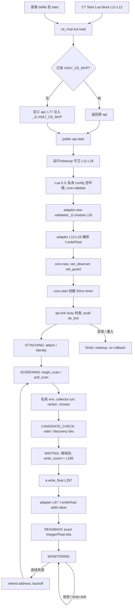
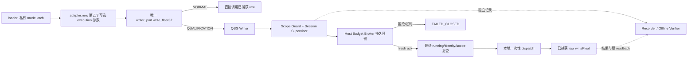

# H3-A7-Q1-QSG-D1 — 设计与只读接入审查

日期：2026-11-20（Asia/Shanghai）。结论：**PARTIAL_H3_A7_Q1_QSG_DESIGN_READY**。
调用清单与两处生产文件的接入路线已完成静态审查；CE pipe 的超时、取消、peer 绑定和实际调度行为尚需独立核查，不能据此宣布接入已验证。

**DESIGN_ONLY；本轮 SYNTHETIC_EXECUTION=NOT_RUN；G1 LIVE NOT APPROVED。**
L01–L12 保持 **0 PASS / 0 FAIL / 12 NOT_RUN**，L12 三个子项均 NOT_RUN。
保留 IMPLEMENTED_PENDING_CE_QUALIFICATION、ATTACHMENT_HANDLE_UNVERIFIED、NOT_PRODUCTION_AUTHORIZED、A6_R3_T1_SEPARATE_PENDING 和历史 R2_T1_FAILED_NOT_QUALIFIED；本文的后续 QSG-R2 不是历史 A6/R2 的重新定级。

## 1. 输入和审查范围

实际完整读取的任务输入为 [D1 Prompt](../codex_tasks/chrome_project_H3-A7-Q1_QSG_D1_codex_prompt.md) 和 [架构提案](../codex_tasks/chrome_project_H3-A7-Q1_QSG_pluggable_safety_architecture.md)。用户消息中带分隔反斜杠的路径不存在；两份完整文件名唯一匹配于 docs/codex_tasks，架构提案实际不在 docs/architecture。此定位差异不改变授权。

审查以真实磁盘源码为准：

- 完整读取 [loader](../../src/ce_mvp.lua)、[adapter](../../src/ce_mvp_adapter.lua)、[core](../../src/ce_mvp_core.lua)、[CT](../../src/ce_mvp.CT)、[配置样例](../../src/ce_mvp_config.example.lua)、[quickstart](../ce_mvp_quickstart.md) 和 [R1 plan](../ce_mvp_q1_r1_plan.md)。
- 读取 collector/ranker 的实际入口、能力环境、取候选、读取、评分、回调及返回链；这不是对全部评分算法正确性的重新验证。
- 完整读取 src/ce_qualification 的 budget、target、recorder、verifier、evidence、schema 和包入口；读取 [runbook](g1_infra_r1_runbook.md)、G1-INFRA-R1 wiring review/summary，解析其 manifest 并复核哈希。
- 读取 [R1 manifest](../../reports/2026-11-20/h3_a7_q1_r1_manifest_20261120T044246Z.json) 和 [L12 附件](../codex_tasks/h3_a7_q1_l12_three_case_addendum.md)。R1 原计划中 L12 两项的旧措辞按附件解释为三项，历史文件不改写。
- 静态读取 mock harness、prestart guard 和相关测试定义；没有加载或执行这些模块，没有编写 PoC。

最小保护检查：HEAD=c214cfd917f51465f09e127a1e0dbb67497cbeca；index SHA-256=b90cbf846ae6a5a61dd85dd9f2952183cc0ec7c0400c0a022b5265d43353c70b。R1 source_sha256 的 28 项、G1-INFRA 的 53 项保护条目和 30 项 artifact hashes 均匹配。后者包含四个指定外部 R3 文件，核验仅限文件字节，不是 R3 运行验证。597 个既有仓库文件已取基线；最终对比见本次时间戳报告和 manifest。

## 2. 当前真实调用图

下图描述冻结 R1，QSG 尚未接入。精确写入清单见 [Writer inventory](h3_a7_q1_qsg_writer_inventory.md)。



加载顺序的要点：loader 顶层仅确定路径、定义函数并注入 H3A7_CE_MVP；不读取 local config、不构造 adapter。Start 的 core.validate 先于 adapter.new。adapter 在其 L13–18 私有表中保存 CE 函数，后改 _G.writeFloat 不会改变该表。随后 adapter L204–205 才加载 ranker/collector 到 env._G=env 的私有环境；两模块末尾的 _G.MVP0 / _G.MVP0FoundList 只写该私有表。core.new 安装观察器与运行/身份 guard，最后 core.start 才建 timer。

实际只有 core L297 一个事务调用及 adapter L97 一个目标 Float32 原语。没有独立的“恢复 writer”：初始空扫描后出现候选、监控确认失效后的新地址、Stop 后新的合法 Start 都最终到同一原语。L10 第一轮走普通初写；active/cleanup Start 分别被 loader L16/L17 拒绝，第二轮 zero_match 不写。异常无自动恢复写、回滚写或重试写；raw 调用已经进入时不能撤销，按一次尝试保守计数。

## 3. 覆盖边界与替代通道

结论来自调用边和能力传递，不只来自关键词搜索：

| 通道 | 当前可达性及依据 |
| --- | --- |
| writeFloat | 可达，唯一实际目标写点 adapter L97；上述所有产品事务汇合于此 |
| writeBytes / writeInteger / writeDouble / WriteProcessMemory | loader/core 无调用；adapter 捕获名单不含它们；collector 的读取代理及 ranker 的 build_candidate 不获得写能力；未发现当前源码调用边 |
| CE MemoryRecord.Value / freeze | CT 两个 record 均为 Lua 控制入口，没有 Value 写赋值/冻结项；源码不取得 AddressList 或 MemoryRecord 对象 |
| Auto Assembler | CT 使用 AA 容器，但四个 Lua block 均有 syntaxcheck 返回；asm 段无分配/注入/数据写指令；Start 仍汇入 loader |
| executeCodeLocalEx | 确实可达，adapter L28 的七个固定 kernel32 地址仅用于 OpenProcess、CloseHandle、GetProcessId、GetProcessTimes、WaitForSingleObject、GetTickCount64、VirtualQueryEx；输出写入 CE 本地 stream，未向目标执行代码 |
| collector/ranker 回调 | adapter 给 collector.run 的固定 opts 无 on_rank_complete、无 truth label；ranker L2993 的可选 callback 在此路径为 nil；协程只让出/恢复控制，无第二 writer |
| Full executor / batch runner / D2/A6 | 未从该 loader/adapter 的固定加载名获得调用边；它们自身的独立写入能力不在 QSG 覆盖声明内，文件受保护 |
| 测试目标初始化/漂移 | 是目标自身的写操作，现有 synthetic target 写 bytearray；与三个 MVP 写尝试分开记账，不能声称会话内所有程序一共只写三次 |

私有 env 包含 debug 表，因此不应把它称为抵抗恶意 Lua 的安全沙箱。已审计 ranker 仅用 debug.getinfo 识别来源；可信前提是固定源码、正常 CE API、无任意脚本/插件并发篡改。QSG 证明目标仅为**已审计 MVP 路径的会话预算**，不覆盖人工 CE UI 写、其他工具、修改过的 Lua/global、内核操作或 OS 全局写归属。

writeFloat 接受地址和值并作用于当前 CE target；它不接受本设计的 broker 身份句柄。最终身份复查可以缩小竞态，但不是将身份核验和 OS 写入合成原子操作。因此仍保留 ATTACHMENT_HANDLE_UNVERIFIED；若未来验收要求无条件的 OS 句柄绑定，现有 raw writer 路线不能满足，必须另行设计，不能用文档消除该限制。[CE 官方 API](https://wiki.cheatengine.org/index.php?title=Lua:writeFloat)

## 4. 选择构造时注入，保持 core 与 CT 不变

选择方案：在 loader 显式选择执行上下文，在 adapter 构造期间注入 Writer Port。QSG 新模块承担 session、IPC、scope、证据适配和 timer 外围监督。NORMAL 不导入这些模块，不探测 broker/pipe/文件，也不隐式启动 Python。



### 4.1 精确最小候选修改位置（本轮未实施）

不是只换一行便完成安全闭环。最小**生产文件集合**为两项；下列 lifecycle/证据接缝同样必需。

| 文件与 R1 行锚 | 拟议改动及不变量 |
| --- | --- |
| ce_mvp.lua L6、L10 前 | 添加私有 execution_mode=NORMAL、qualification context；新增 configure_execution(request) 供显式 QSG loader 调用。选择 QUALIFICATION 即锁定模式，即使初始化失败也不回 NORMAL；不得自动发现/加载插件 |
| ce_mvp.lua L20–28 | 保持 Lua 版本、config 加载、core.validate 及原拒绝次序；仅在验证后调用 supervisor.prepare_start(validated)，把上下文作为第五参数传给 adapter.new；core.new 后 bind_core(instance) 再 instance.start；构造/Start 失败必须撤销 run lease 并清理已构造 adapter |
| ce_mvp.lua L34 | QUALIFICATION Stop 先本地 revoke/cancel 递增 generation，再执行原 stop；最后读取 cleanup evidence。撤销/记录错误不能阻止原资源清理 |
| ce_mvp_adapter.lua L11、L12 附近 | 将签名追加为 new(cfg,ce,load_module,observation_source,execution)，不挤占第四个 source 参数；nil 保持 NORMAL。错误 mode/缺失资格工厂直接拒绝，不能通过 or fallback 取得 raw |
| ce_mvp_adapter.lua L44–48 | QUALIFICATION 才追加本地安全状态/lease guard；原 checked/poison 和 core 安装的 guard 仍执行。不得用 set_guard 外部覆盖来替代核心 guard |
| ce_mvp_adapter.lua L93–101、return a 前 | 构造唯一 port，将 L97 原始调用替换为 port:write_float32(request)；request 取真实 addr/value/cfg.write_bits。raw 只给构造时 QSG 工厂的闭包，不能出现在返回表或状态快照。原 intent/result observe 顺序保留 |
| ce_mvp_adapter.lua L210–248、L269–288 | 将成功 choose/poll 返回的 candidate 做只读副本交给上下文，绑定真实 raw 地址、结构和 mapping；在 reserve 后的最终校验中再次调用既有 valid/read_bits/checked。不得从状态显示字符串猜地址 |
| ce_mvp_adapter.lua L102–108 | QUALIFICATION 的 readback sidecar 关联当前 attempt 与实际 bits/float；保留原读取顺序和返回值。没有回读成功不能产生 verified 结论 |
| ce_mvp_adapter.lua L309–313、L320–338 | 在 timer 创建时显式绑定 supervisor.wrap_tick(callback)，前后检查/采集 core evidence；close 最前本地撤销 port，完成原资源清理后汇报。禁止运行后改 timer/raw global；清理阶段不得因 IPC 失败跳过资源释放 |

L97 的候选替换形状仅为审查说明：

```diff
- function M.new(cfg, ce, load_module, observation_source)
+ function M.new(cfg, ce, load_module, observation_source, execution)
  ... construct and validate writer_port before returning a ...
- local result=f.writeFloat(addr, value)
+ local result=writer_port:write_float32({address=addr,value=value,value_bits=cfg.write_bits})
```

这不是可运行补丁；工厂、失败清理和 supervisor 必须按 [契约](h3_a7_q1_qsg_contract.md) 一并实现和测试。core L297 保留 a.write_float(addr,value)；不修改 core、collector/ranker、Full executor、配置字段白名单、样例、CT、旧 R1 freeze 或 L12 附件。QSG 模式配置属于独立受批准控制上下文，不能往 core 严格白名单的 local config 塞新字段。

### 4.2 无 core 修改时，证据和退休如何获得

loader 在 core.new 后提供只读 evidence/status getter 和受限 stop 回调；adapter 构造期间安装 timer 包装，正常每 tick 后读取原 core.evidence，不通过非阻断观察器做授权。writer 前再同步排空证据。core 的 address_retired 事件经 per-run sequence 与此前选中候选的真实地址/alias 映射关联，broker 在下次 dispatch 前持久记录退休；目标侧 retire/decommit 是第二独立来源。映射缺失、ring 丢弃、重复 alias 不一致或退休未同步时拒绝写。不可仅把 target 退休事件或猜测 A0/A1 当成 core 退休证明。

L04 的 candidate rank/address、write_intent alias 与原事件序号建立显式绑定；L07 必须同实例、不同地址并有旧地址退休证据。任何无法可靠绑定的实现均返回 BLOCKED_WRITE_GUARD_WIRING，不静默增加 core 修改范围。证据 sidecar 可独立失败并关闭 writer；它不依赖 core L159 吞异常的 observe。

### 4.3 NORMAL 等价性

保留 public start()/stop()/status()/evidence()/print_evidence() 的参数与结果；start 成功仍 true,nil，已有活动/清理拒绝理由不变；loader 外层错误仍按原方式打印/截断。a.write_float 仍返回 raw 的第一个值：true/false/nil/非布尔不强制归一；raw exception 在 NORMAL 原样传播到现有核心 pcall。writer_port 不添加重试、额外 native/clock/I/O、IPC、日志或资格计数。

NORMAL 下配置核验、函数捕获次序、扫描阈值、readback、drift、timer/cleanup、每 Start 重置产品计数的语义保持现状。QSG 模块缺失或文件语法错误但未选择资格模式时，不得影响 NORMAL。NORMAL **没有**三次会话预算保证。

QUALIFICATION 保留旧 intent 在 port 之前的顺序，因此原 core.write_count 与 adapter_write_attempts 在拒绝时可能已加一，不能再解释为 raw 次数。新 sidecar 分别记录 port_entries、reservations_consumed、raw_dispatch_attempts、raw_returns_true、verified_writes；旧诊断以明确的 QUALIFICATION 计数语义包封，不直接送入旧 verifier 的 intent=dispatch 规则。

## 5. 可插拔生命周期

UNLOADED -> LOADED_DISARMED -> POLICY_VALIDATED -> ARMED 是资格组件的显式过程，不在 CT 打开或 status 时自动进行。ARM 必须同时具备未来完整 G1 授权、固定新候选哈希、合成准入、可信 broker/storage/transport、CE/target 身份与 recorder 就绪。本轮这些条件不成立。

ARMED 内 run 子状态为 IDLE -> STARTING -> RUNNING -> STOPPING -> STOPPED；正常 Stop 结束 run lease，持久资格 session 与预算继续保留。后续获准 Start 可申请新 run，不能重新 provision 会话。L10 清理中的 public Start 先命中原 CLEANUP_IN_PROGRESS，不消耗新的 run/write slot。

任何 safety/证据/身份/存储不确定进入 FAILED_CLOSED，撤销所有本地 receipts 并阻止后续派发；不自动重连后恢复 ARM。Stop 可重复调用且继续本地清理。只有 session 最终封存、所有 run 已结束、未决 attempts 已标注且资源关闭后插件可卸载；当前已锁定的资格 loader 不变回 NORMAL。重复 dofile 返回 singleton；换新 CE/显式重新绑定必须从 broker 恢复同一 enrollment，不能新建 session 绕过旧预算。任意清除全局/篡改源码后手工 NORMAL 写属于覆盖声明之外，不能计入合格证据。

## 6. 现有基础可复用之处及必须新增的部分

| 当前实现 | 源码事实 | R2 设计处理 |
| --- | --- | --- |
| budget.py | validate_policy L40–44、SessionGate L108–109 只接受 SYNTHETIC；dispatch L226 同一 Python 锁内调用 fake_write | 复用规则思想和故障样例；新增独立版本的跨进程 broker，不删除旧 synthetic 限制；把 reservation/claim/outcome 分离为持久协议 |
| recorder.py | L38–39 拒绝 CE live source；bindings 是调用方声明 | 新 QSG sidecar 记录真实 request/attempt/address 及 CE 原序号；现有 normalizer 只处理旧 synthetic，不能改个 origin 就当 live |
| target.py | L90 强制 SyntheticMemory；target_sha256 当前是 recorder 文件，不是 OS 镜像证明 | 未来单独实现 target-self provider 与身份/provenance；Python 场景须分别固定解释器、脚本、layout/provider hash |
| verifier.py | 所有 live 项固定 NOT_RUN；不导入 gate/target；当前 intent 与 dispatch 个数相等 | 新独立 verifier adapter 识别 QUALIFICATION 拒绝、reservation 无 dispatch、claim 无 call、raw outcome 与 readback 分离；旧 verifier 保持不变 |
| evidence.py/schema | 普通 SHA 链 + 外部 retained seal；future labels 不是实现 | 新版本包封和 kind 约束，不让旧 schema 自动接受新证据；记录可信锚的来源与局限 |

建议新增实现位置（均未创建）：src/qualification/qsg_loader.lua、qsg_writer.lua、qsg_scope.lua、qsg_supervisor.lua、qsg_transport.lua、qsg_recorder.lua；src/ce_qualification/qsg_broker.py、qsg_store.py、qsg_verifier.py、qsg_evidence.schema.json；tests/qualification/test_qsg_*.py 及独立 mock fixture。所有这些仍需后续授权，默认只有合成 backend，live arming 不可用。

## 7. 传输选择及未证明项

Windows 本机 named pipe 只是候选。实际磁盘 celua.txt L3269 把 Timeout 描述为秒，L3309 把 connectToPipe timeout 描述为毫秒；L3275 的 lock 允许等待和递归。不能假定设置一个数字便已证明有限超时或非重入。文件 SHA-256 已复核为 fbf6f67773788e6d117b40dcc3eaa96688d1e44ba0531835336a4b8262400b77。

设计要求明确 framing、完整请求期限、peer 绑定和取消；其抽象契约可用 fake transport 合成验证，但 CE 7.6 x64 / Lua 5.3 上是否能实现全部要求为 NOT_RUN。若内置 LuaPipe 无法满足，保持阻断，另行评审本机 transport 实现；不得改用无限等待、debug hook 或 Auto Assembler 注入。

Windows 支持显式 pipe 安全描述符及获取 pipe peer PID；PID 仍需绑定创建身份和镜像哈希。此处只是候选 API 依据，没有调用原生 API。[Named Pipe access](https://learn.microsoft.com/en-us/windows/win32/ipc/named-pipe-security-and-access-rights)、[Client PID](https://learn.microsoft.com/en-us/windows/win32/api/winbase/nf-winbase-getnamedpipeclientprocessid)、[Server PID](https://learn.microsoft.com/en-us/windows/win32/api/winbase/nf-winbase-getnamedpipeserverprocessid)

文件落盘和 pipe ack 不是同一保证。FlushFileBuffers 对 server pipe 可能等待客户端读完，不能拿它代替带 deadline 的 durable reservation 协议。物理断电、目录元数据持久性、存储回滚抵抗及 CE UI 取消时延均未核验。[Microsoft FlushFileBuffers](https://learn.microsoft.com/en-us/windows/win32/api/fileapi/nf-fileapi-flushfilebuffers)

## 8. 交付与下一步权限

[接口与不变量](h3_a7_q1_qsg_contract.md)、[逐路径清单](h3_a7_q1_qsg_writer_inventory.md)、[合成矩阵](h3_a7_q1_qsg_synthetic_test_plan.md) 共同构成设计。当前真实接入仍为 BLOCKED_WRITE_GUARD_WIRING；设计不改变该运行状态。

下一步最小授权范围是：允许建立独立 QSG-R2 候选，仅修改 src/ce_mvp.lua、src/ce_mvp_adapter.lua 的上述接缝，新增 QSG/broker/证据适配和纯合成测试；保留旧 R1 原字节和清单，输出新候选 patch/hash。transport 的源码核查可随 R2 做，任何 CE/原生 pipe 环境执行须另列有限授权；不得自动扩为 G1 内存写资格。

本轮没有需要代用户批准的实施选择，也没有执行 R2。G1 继续 NOT APPROVED；不要求、推导或生成 MVP_ACCEPTED。
